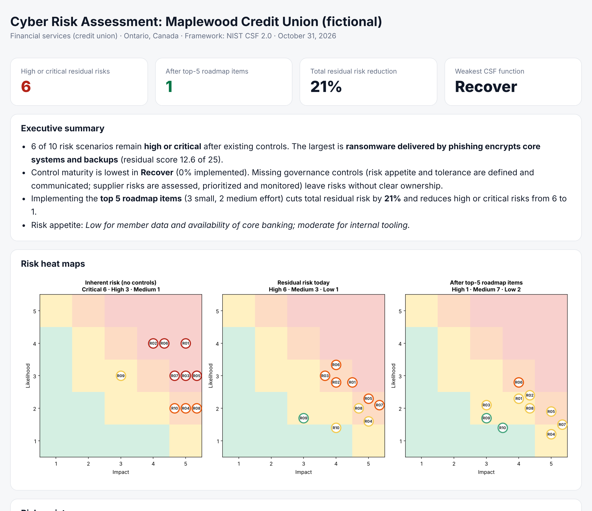
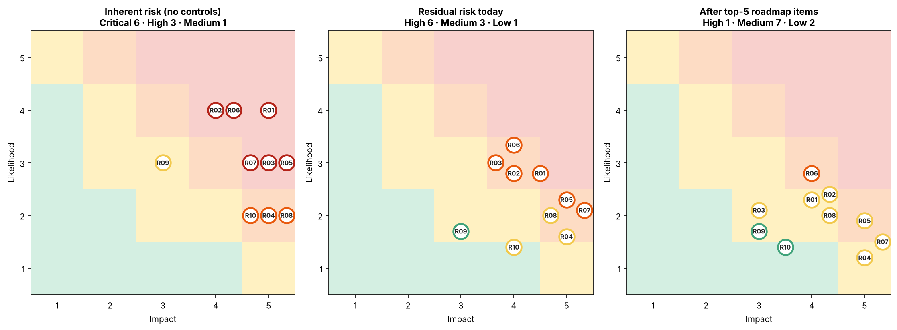
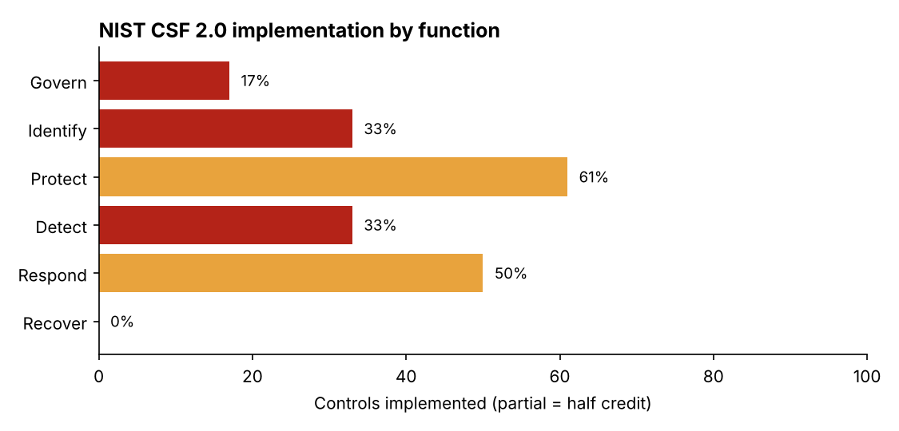

# 🏛️ GRC Risk Toolkit: cyber risk assessment as code


Turns a cyber risk assessment from a static spreadsheet into **version-controlled, repeatable code**. Describe an organization's assets, its controls (mapped to **NIST CSF 2.0**), and its threat scenarios in YAML. The toolkit scores **inherent and residual risk**, builds a **risk register** (Excel + CSV), ranks a **remediation roadmap by risk reduction per unit of effort**, and produces an **executive report** with heat maps.



---

## Example: Maplewood Credit Union (fictional)

An Ontario credit union with 180 staff and 42,000 members, assessed against **10 threat scenarios**, **9 assets**, and **22 NIST CSF 2.0 controls**.

| | Today | After the top-5 roadmap items |
|---|---|---|
| **High or critical residual risks** | **6** | **1** |
| Total residual risk | 97.8 | 77.4 (**−21%**) |
| Effort required | | 3 small + 2 medium items |



### The prioritized roadmap

Every control gap is simulated as "implemented" and ranked by how much total residual risk it removes, divided by effort (S = 1, M = 2, L = 4):

| # | NIST CSF 2.0 | Action | Effort | Risk reduction | Risks addressed |
|---|---|---|---|---|---|
| 1 | ID.AM-07 | Build a data inventory (where member data lives) | M | −7.4 | Vendor breach, cloud exposure, insider |
| 2 | RS.CO-02 | Document regulator and stakeholder notification | S | −3.7 | Vendor breach, late breach reporting |
| 3 | RC.RP-03 | Verify backup integrity before restoring | S | −2.7 | Ransomware, backup failure |
| 4 | PR.AA-03 | Enforce MFA on VPN and member online banking | M | −5.2 | Ransomware, VPN exploit, credential stuffing, BEC |
| 5 | PR.AT-01 | Phishing simulations on top of annual training | S | −2.6 | Ransomware, business email compromise |

**Why this order matters:** a data inventory removes the most risk (−7.4) because three scenarios depend on knowing where member data lives. MFA is close behind (−5.2) and touches four risks. Three small items deliver quick wins in weeks. That's the conversation a CISO has with a board, backed by numbers instead of opinion.



## Scoring methodology

The model is documented so it can be challenged, like any GRC methodology:

| Step | Rule |
|---|---|
| Inherent risk | Likelihood (1-5) × the worst impact dimension (financial, operational, regulatory, reputational) |
| Control effectiveness | Average of the linked controls: implemented = 1.0, partial = 0.5, not implemented = 0 |
| Preventive controls (Govern, Identify, Protect, Detect) | Reduce **likelihood** by up to 60% |
| Response controls (Respond, Recover, backups) | Reduce **impact** by up to 40% |
| Rating | Critical ≥ 15 · High ≥ 10 · Medium ≥ 5 · Low < 5 (on a 25-point scale) |
| Roadmap priority | Residual-risk reduction ÷ effort |

## Deliverables generated

| File | For |
|---|---|
| `risk_register.xlsx` | Risk owners: register, roadmap, control assessment with evidence, and asset inventory (4 sheets, colour-coded ratings) |
| `risk_register.csv` | Importing into a GRC platform |
| `executive_report.html` | Leadership and the board: summary, heat maps, top risks, roadmap, maturity |
| `heatmaps.png`, `csf_maturity.png` | Slides |

## Why "as code"

- **Repeatable:** re-run after every control change and watch residual risk move
- **Reviewable:** assessment changes go through pull requests, with history and sign-off
- **Validated:** unknown control IDs, invalid CSF identifiers, out-of-range scores, and broken YAML fail loudly instead of silently skewing results
- **CI-ready:** `--fail-above 12` exits with code 1 if any residual risk exceeds the tolerance, so risk appetite becomes an automated check

## Quick start

```bash
pip install -r requirements.txt
python -m grc assess examples/maplewood --out reports/maplewood
pytest -q
```

To assess your own organization, copy `examples/maplewood/` and edit the four YAML files.

## Tests

`15 passed`: rating thresholds, residual never exceeding inherent, register ordering, control-effect maths, roadmap ranking, what-if analysis not mutating the baseline, input validation, and the CLI and CI gate.

## Limitations

- Scores are ordinal judgements made more consistent, not actuarial probabilities. A quantitative extension (FAIR-style loss ranges) is a natural next step.
- Control effectiveness is averaged per scenario. A real assessment might weight key controls (for example, MFA) more heavily.

---

Built by **Mohammed Bello Ibrahim** · Cybersecurity risk assessment extern (vCISO) · [CalGrid AI](https://calgridai.com) · [LinkedIn](https://www.linkedin.com/in/mohammed-bello-ibrahim-7521b62a2/)

*Maplewood Credit Union is fictional. All data in the example is made up for demonstration.*
